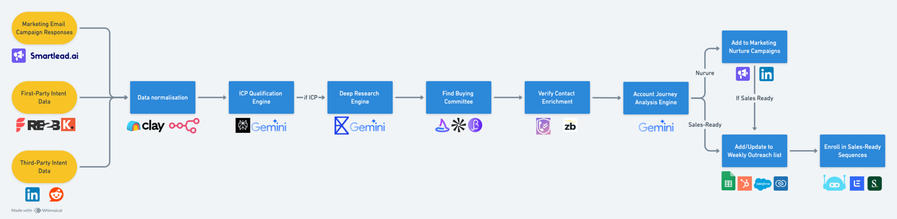
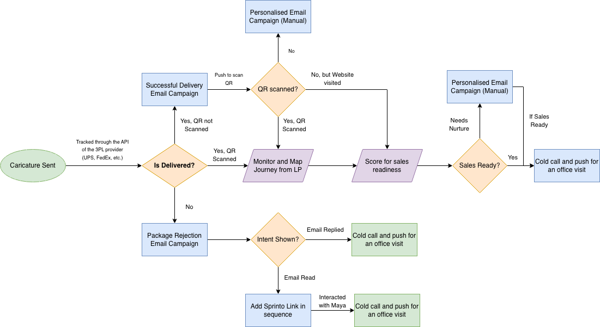

# GTM Engineering Portfolio

I'm Sashank Koundinya, a GTM engineer with 5+ years across SDR, AE, CSM, marketing and content. I build outbound motions from zero along with the data layer behind them. This repository holds three systems I designed and built to move B2B teams from a target account to a booked conversation.

| Project | What it does | Stack |
|---|---|---|
| [Rover](rover/) | Connects a customer's CRM and team chat to n8n through OAuth, then runs an allbound workflow that qualifies inbound accounts against an ICP, researches them with Exa and Claude, finds the buying committee and writes everything to HubSpot and Slack. | FastAPI, React, n8n, Exa, Claude, Apollo, HubSpot, Slack |
| [Caricature Campaign](caricature-campaign/) | Runs a physical direct-mail campaign (a caricature of each prospect with a QR card) as a 13-day state machine: courier tracking, first-party website intent, percentile-tiered scoring, Instantly sequences, rep call tasks and human-approved AI nurture emails. | n8n, Supabase (Postgres views), Ship24, Instantly, HubSpot, Claude |
| [Stage](stage/) | A multi-tenant workspace for SDR teams: "the pipeline before your CRM". Weekly researched account rosters, contact enrichment, meeting prep briefs, post-call emails and task management, with HubSpot sync only once a prospect is ready. | React, TypeScript, Supabase (RLS, Edge Functions, Realtime, pg_cron), Claude Code agents |

## Architecture

**Rover**



**Caricature Campaign**



Each project's README maps its diagram to the code.

## Experience behind these projects

**Interact AI**, seed-stage B2B SaaS: Founding Account Executive (Aug 2025) to Founding Sales Lead (Nov 2025) to Head of Business (Jun 2026). Promoted twice in 11 months.
- Ran an AI-personalized ABM campaign end to end, from brief to automation and ongoing maintenance: caricature mailers to 175 accounts, research via Exa, Firecrawl and Claude, and follow-ups triggered by courier-API tracking. Generated $1.7M in pipeline and $350K closed-won. [caricature-campaign/](caricature-campaign/) rebuilds its automation layer as n8n workflows from the campaign brief.
- Built the SDR control center that became [Stage](stage/). My 3-rep SDR team added $225K in pipeline in 3 weeks, booked 35% more meetings a week, and got 2 to 3 hours back per rep every day.
- Built an automated lead enrichment system (Clay, Make, HubSpot) that ranks high-intent target accounts, cutting manual research time by 70%.
- Built 0 to 1 GTM motions for both products, InteractGen (AEO platform) and the helper-agents suite. Closed $325K of InteractGen's $450K pipeline ARR and $550K in revenue for the helper-agents suite.
- Grew the sales function from one person to a 4-member pod and built a 30-day SDR onboarding program: 100 qualified meetings a month at an 85.7% show-up rate, and $2.5M in pipeline in the team's first quarter.

**GTM Consultant (Contract), KeystoneGTM** (Mar 2025 to Jul 2025)
- Redesigned account-prioritization data processes for growth-stage clients, driving 2.5x more qualified sales conversations.
- Built multi-channel outbound playbooks and the Clay, n8n and Make automations that run them.

**Customer Success Manager, Factors AI** (May 2024 to Mar 2025)
- Owned a $264K ARR international account portfolio, 18% of company ARR.
- Ran funnel audits to find pipeline gaps, then designed and automated the fixes across client stacks (Clay, n8n, Make.com, HubSpot, Salesforce).

**Earlier:** independent GTM consultant to 25+ B2B companies (roughly $1.5M in active pipeline), Founding SDR at Moolya Software Testing (256+ qualified meetings in 6 months), Presales Lead at Mako IT Lab.

**Stack:** Clay, n8n, Make.com, Zapier, HubSpot and Salesforce (admin and custom implementation), Zoho CRM, Supabase, Vercel, Claude Code. Enrichment and outreach: Apollo, FullEnrich, Prospeo, ContactsOut, IcyPeas, SureConnect, TitanX, Lusha, SignalHire, ZoomInfo, Smartlead, Instantly.

## What this shows

- **Systems over scripts.** Each project keeps state in one place (Postgres or the CRM) and treats every external tool as replaceable through configuration.
- **Data you can audit.** Every research claim carries a source ID, every intent signal lands in an event log, and every CRM write is logged against the record it touched.
- **Cost and safety controls.** Fit checks run before expensive research, enrichment keys are bring-your-own per workspace, OAuth tokens are encrypted at rest, and AI-written outreach waits for human approval.
- **Tested before shipped.** Rover's API has a pytest suite with mocked provider and n8n calls. The caricature campaign's scoring logic is asserted in SQL against Postgres, and its workflow logic is executed against mock payloads. Every n8n workflow is validated against n8n 2.48's own node definitions. Stage runs Deno, database and worker tests in CI.

## Repository layout

```
rover/
  backend/            FastAPI service: auth, MFA, OAuth broker, n8n credential handoff, tests
  frontend/           React + Vite connection dashboard
  workflows/          Allbound account research workflow for n8n, plus the Python generator that builds it
caricature-campaign/
  workflows/          Six n8n workflows
  supabase/           Schema, event log and scoring views
  website/            First-party tracking snippet
  generator/          Python generator for the six workflows
  tests/              Workflow, snippet and SQL view tests
  docs/               Campaign brief and setup guide
tools/
  n8n-schema-check/   Validates workflow JSON against a real n8n release's node definitions
stage/
  roster/             The Stage app: React frontend, Supabase backend, research worker
  .claude/            Claude Code agents and the research worker skill
  .github/workflows/  CI pipelines as used in the product repository (they do not run from this subfolder)
```

## Running the tests

```bash
# Rover API
cd rover/backend && pip install -r requirements-dev.txt && pytest

# Caricature campaign workflows and website snippet
cd caricature-campaign/tests && npm install && npm test

# Caricature campaign scoring views (use an empty scratch Postgres database: the test inserts sample data)
psql "$DATABASE_URL" -v ON_ERROR_STOP=1 -f caricature-campaign/supabase/migration.sql -f caricature-campaign/tests/sql/views_test.sql

# Every n8n workflow against n8n 2.48's node definitions
cd tools/n8n-schema-check && ./setup.sh && node check.js ../../rover/workflows/*.json ../../caricature-campaign/workflows/*.json

# Stage app build and worker tests
cd stage/roster && npm ci && npm run build && cd worker && npm ci && npm test
```

Each project folder is self-contained: its README covers setup, credentials and how to run it, and each n8n workflow carries a setup note so a single downloaded JSON file explains itself.

## Rights

Published for review as part of my portfolio. All rights reserved; no license is granted to copy, modify or redistribute this code.
