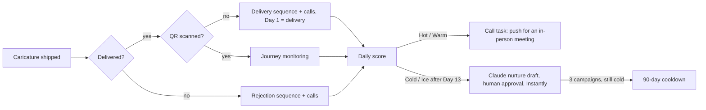

# Caricature Campaign

Automation for a direct-mail campaign I designed for InteractAI. Each target prospect receives a caricature of themselves with a card carrying a personal QR code. Delivery, website behaviour, email engagement and calls then decide what happens next, for every prospect, for 13 days and beyond. The original brief is in [docs/campaign-brief.pdf](docs/campaign-brief.pdf); the setup guide is in [docs/setup.md](docs/setup.md).



## Six workflows, one state store

The workflows never call each other. They share state through Supabase: a `prospects` table, an append-only `events` log, and views that compute scores and due work.

| # | Workflow | Trigger | Job |
|---|---|---|---|
| 1 | Prospect Intake | Webhook | Validates prospects, upserts HubSpot contacts, builds each prospect's tracked URL and print-ready QR, creates the Ship24 tracker |
| 2 | Delivery Tracker | Ship24 webhook, manual form | Maps courier milestones to delivered or not delivered, sets Day 1, ignores late or out-of-order updates |
| 3 | Intent Ingestor | Website pixel, Instantly, Factors, Maya webhooks | Logs every signal once (deduplicated by key) and fires instant actions: QR scan pulls the prospect out of the delivery sequence, a reply stops sequences and creates a call task |
| 4 | Intent Scorer | Daily | Writes 30-day scores and tiers to Supabase and HubSpot, creates the first sales-ready call task, starts cooldowns |
| 5 | Cadence Runner | Hourly | Enrolls prospects in Instantly when due and creates the Day 2, 5, 10 and 13 call tasks with voice-note scripts |
| 6 | Nurture Drafts | Daily + approval link | Claude drafts a nurture email, Slack shows Approve and Reject links, approval queues it in Instantly |

## Design decisions

- **Scoring lives in SQL.** Signals in a 30-day window are summed and capped at 100: website visit 2, three or more visits in 14 days 15, QR landing 35, demo engaged 40, QR session reaching the contact page 45. Tiers come from `cume_dist()` over the active cohort: top 25% Hot, up to 45% Warm, up to 60% Cold, the rest Ice.
- **Ties take the lower tier.** With a small cohort most prospects start at zero. Ranking ties by "share of the cohort at or above this score" keeps every zero-score prospect in Ice, so the top-45% sales-ready rule never promotes someone with no intent.
- **Day counting is calendar-based** in the campaign's timezone, and only the latest due call is created, so a missed run never floods reps with stale tasks.
- **First-party identity.** The QR URL carries a per-prospect token in `utm_content`. The website snippet stores it and reports only that prospect's sessions, through an image pixel, so it needs no CORS setup.
- **AI drafts, humans send.** Nurture emails are written by Claude under tight rules (no tracking references, only approved proof points) and go out only after someone clicks a one-time approval link.
- **Generated, not hand-wired.** The six workflows are built by `generator/` from Python, so 157 nodes stay consistent and `validate.py` checks wiring, node references and expression syntax on every build.

## Tests

| Suite | What it checks |
|---|---|
| `tests/sql/views_test.sql` | Score cap, 30-day window, session counting, tier ties, due enrollments, call-day selection, nurture and cooldown candidates, against real Postgres |
| `tests/workflows_test.js` | Runs every Code node and renders every expression in all six workflows against mock Ship24, Instantly, Factors and pixel payloads |
| `tests/snippet_test.js` | Simulates browsing sessions to confirm which events the website snippet sends |

```bash
cd tests && npm install && npm test
psql "$DATABASE_URL" -f ../supabase/migration.sql -f sql/views_test.sql
cd ../generator && python build_all.py /tmp/out && python validate.py /tmp/out/1_Caricature_Prospect_Intake.json
```
