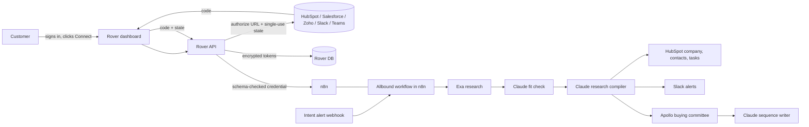

# Rover

Rover lets a customer connect their CRM and team chat once, then runs GTM workflows in n8n against those accounts. It has two halves:

1. **Connection service** (`backend/`, `frontend/`): a FastAPI app and React dashboard. The customer signs in, connects HubSpot, Salesforce, Zoho CRM, Slack or Microsoft Teams through OAuth, and Rover hands the resulting credentials to n8n through n8n's public API.
2. **Allbound account research** (`workflows/`): an n8n workflow that fires when an account shows intent, checks it against the ICP, researches it, and puts the result in HubSpot and Slack using the credentials Rover created.



## Connection service

| Endpoint | Purpose |
|---|---|
| `POST /users`, `POST /token` | Sign-up and sign-in (JWT). Sign-in asks for a TOTP code once MFA is on. |
| `POST /mfa/setup`, `/mfa/enable`, `/mfa/disable` | Authenticator-app MFA with a QR code. |
| `GET /oauth/providers` | Which providers this server has OAuth apps for, and which the user has connected. |
| `POST /oauth/{provider}/authorize` | Returns the provider's consent URL with a single-use state value. |
| `POST /oauth/callback` | Exchanges the code, reads the connected account, stores tokens, creates the n8n credential. |
| `GET /oauth/credentials`, `DELETE /oauth/credentials/{id}` | Lists connections (never tokens) and disconnects, removing the n8n credential too. |

**Security decisions**

- OAuth tokens and MFA secrets are encrypted at rest with Fernet. The API never returns a token to the browser.
- The OAuth state value is single-use, expires in 10 minutes and is bound to the user who started the flow, so one user cannot complete another's connection.
- The redirect URI is fixed on the server. Clients cannot supply their own, which closes an open-redirect path.
- Five failed sign-ins lock the account for 30 minutes, and wrong MFA codes count toward the limit.
- Before creating an n8n credential, Rover fetches n8n's schema for that credential type (`GET /api/v1/credentials/schema/{type}`) and fits the payload to it. A mismatch is reported on the connection instead of failing silently. For OAuth2 credential types n8n refreshes tokens itself after the handoff.
- Every secret comes from the environment. The service refuses to start without `SECRET_KEY` and `TOKEN_ENCRYPTION_KEY`.

## Allbound account research workflow

`workflows/allbound_account_research.json` (50 nodes plus a setup note) runs per account:

1. Normalises the domain from the intent webhook and stops if the seller and ICP config is incomplete.
2. Looks the company up in HubSpot to decide between the new-account and existing-account paths.
3. Researches with three Exa searches (company profile, last 90 days of news, the company's own site) and numbers every source.
4. **Claude fit check** returns ICP match, tier, a 0 to 100 score, confidence, missing data and cited evidence. Unsupported criteria count as unmet.
5. Pulls the website journey from the configured intent provider, then **Claude research compiler** classifies the stage (Marketing Nurture or Sales Ready) and writes why-now, signals with dates and openers.
6. **New accounts:** Slack alert, HubSpot company, Apollo buying committee (no-credit people search, then enrichment), verified emails only, contacts associated to the company, a **Claude-written three-email sequence plus LinkedIn note** per contact saved as a HubSpot note.
7. **Existing accounts:** refreshes the research properties and creates a BOFU task for the company owner unless one is already open.

The workflow is generated from `workflows/generator/build_allbound.py`, which keeps the nodes consistent and lets `validate.py` check wiring, node references, expression syntax and leftover secrets before export. It is also checked against n8n 2.48's own node definitions with [`tools/n8n-schema-check`](../tools/n8n-schema-check/).

## Run it

```bash
# API
cd backend
python -m venv .venv && source .venv/bin/activate
pip install -r requirements-dev.txt
cp .env.example .env        # fill SECRET_KEY, TOKEN_ENCRYPTION_KEY, n8n and OAuth app values
pytest                      # 12 tests, all provider and n8n calls mocked
uvicorn main:app --reload --port 8000

# Dashboard
cd ../frontend
cp .env.example .env
npm install && npm run dev  # http://localhost:3000
```

Register `http://localhost:3000/oauth/callback` as the redirect URL in each provider's OAuth app.

**Workflow setup in n8n** (the same steps are in a note inside the workflow, so a downloaded JSON is self-explanatory):

1. Import `workflows/allbound_account_research.json` and fill the **Seller & ICP Config** node. `seller_company`, `seller_offering`, `icp_definition` and `slack_channel_id` are required; the workflow stops with a clear error until they are set. `journey_api_url_template` is your intent provider's account-journey URL with `{domain}` where the domain goes.
2. Select credentials: HubSpot OAuth2 and Slack API (Rover creates both, named `rover:<user id>:<provider>`), Header Auth `x-api-key` for Exa, Header Auth `X-Api-Key` for Apollo (a master key, required by the people search endpoint), Header Auth for the intent provider, and Anthropic for the three Claude model nodes.
3. Create these HubSpot company properties: `allbound_journey_stage`, `allbound_in_market`, `allbound_first_intent_date` (date), `allbound_icp_tier`, `allbound_icp_match`, `allbound_research_notes` (multi-line text).
4. Send a test account: `curl -X POST <webhook URL> -H 'Content-Type: application/json' -d '{"domain":"acme.com","company_name":"Acme"}'`.

## Version history

The first version was a prototype with a mock dashboard. This version rewrites it: undefined request objects in three endpoints, an OAuth redirect route the frontend never served, MFA that was never checked at sign-in, a lockout counter that never incremented, n8n credential types that did not match what the workflow nodes use, tokens returned to the browser, and hardcoded keys. The workflow moved from a retired Gemini model and a hosted research API to Exa plus Claude, and its client-specific configuration was removed.

## Limits

The OAuth adapters and n8n handoff are tested against mocked responses, not live provider apps. Provider scopes and n8n credential schemas change between versions, which is why the schema check exists.
