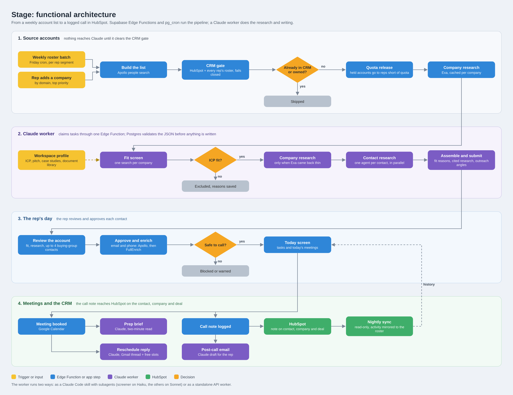

# Stage

Stage is an SDR workspace I designed and built: the pipeline before your CRM. SDR teams work from one place instead of ten tabs. Researched accounts arrive in a weekly roster, contacts get enriched, meetings get prep briefs, post-call emails get drafted, and a prospect is written to HubSpot only when it is ready for the CRM.

This folder mirrors the product repository. The app lives in [roster/](roster/); its [README](roster/README.md) is the full deployment guide.

## Architecture



Accounts clear the CRM gate before any AI spend, the Claude worker researches and screens them, the rep approves and enriches contacts, and only the call note goes to HubSpot. The table below maps the layers.

| Layer | What it uses |
|---|---|
| Frontend | Vite, React 18, TypeScript, deployed on Vercel. Tabs for Accounts, Meetings, Dashboard, Task Center and Admin, live through Supabase Realtime. |
| Data | Supabase Postgres with row level security, 33 migrations, multi-tenant workspaces, invite-only sign-up, per-workspace roles and permissions |
| Server logic | 18 Supabase Edge Functions: HubSpot sync and notes, CRM guard, Apollo and FullEnrich enrichment, Google Calendar, prep briefs, post-call and reschedule emails, OAuth callback, weekly roster |
| Scheduling | pg_cron jobs call the Edge Functions with a shared secret read from Supabase Vault |
| Research | A queue in Postgres claimed by a Claude worker (see below) |
| Secrets | Integration keys and OAuth tokens per workspace in Supabase Vault. Enrichment and AI keys are bring-your-own, with no fallback to the platform's own keys. |

## AI: Claude workers only

Every research and writing step runs on Claude. The app itself never calls a model; it queues tasks in Postgres, and a Claude worker claims them, runs the agents and submits validated JSON. There are two ways to run the same worker:

| Worker | How it runs | Where |
|---|---|---|
| Claude Code worker | A Claude Code routine (or a local Claude Code session) runs the `roster-research` skill, which drives six subagents | `.claude/skills/roster-research`, `.claude/agents/` |
| API worker | A Node process calls the Anthropic API with the same agent prompts and research budgets (default model `claude-opus-5-5`, set with `ROSTER_MODEL`) | `roster/worker/api-worker.mjs` |

In the Claude Code worker, `company-screener` runs on Haiku (one search per company to drop clear ICP failures before research is spent) and the five others run on Sonnet: `company-researcher`, `contact-researcher`, `prep-writer`, `post-call-writer` and `reschedule-writer`.

## Run it from this folder

Treat `stage/` as the project root. The Claude Code worker loads `.claude/` from the folder Claude Code opens, and the worker's commands run from here.

```bash
cd stage/roster
npm ci && npm run build          # frontend type-check and production build
cd worker && npm ci && npm test  # API worker tests

cd ../..                         # back to stage/
deno test --allow-env --allow-net=localhost roster/supabase/functions/_shared/

# Claude Code worker: open stage/ in Claude Code with ROSTER_WORKER_URL set, then ask it to "run the roster worker"
# API worker:
ROSTER_WORKER_URL=... ROSTER_WORKER_TOKEN=... ANTHROPIC_API_KEY=... node roster/worker/api-worker.mjs
```

Deploying the full product (Supabase project, Edge Functions, Vercel, HubSpot and Google apps) is covered step by step in [roster/README.md](roster/README.md). To use the CI pipelines, copy `stage/` into its own repository so `.github/workflows/` sits at the root.

## Engineering choices worth a look

- **The database is the referee.** The worker never edits tables directly. It claims tasks and submits JSON, and Postgres functions validate every result before it lands.
- **Research once per company, separately per contact.** The company researcher runs once per account and contact researchers reuse its output, which keeps AI spend proportional to accounts rather than people.
- **Fit check before research.** The company screener filters accounts before the expensive research step runs.
- **Masked-surname matching.** When Apollo hides a surname ("Arjun Sh***a"), `linkedin.ts` finds the right profile through Exa by matching visible letters and confirming with role or company, and rejects namesakes.
- **Collision check before every call.** `crm-guard` answers "is it safe to call this person?" by checking every rep's roster and HubSpot live, then blocks or warns when another rep called recently or the contact is already a customer or open opportunity.

## Tests

- Deno unit tests next to the shared Edge Function code (`roster/supabase/functions/_shared/*_test.ts`): `deno test roster/supabase/functions/_shared/`
- Database tests with pgTAP (`roster/supabase/tests/db/`, run with `supabase test db`), including workspace isolation across tenants, plus SQL tests that CI runs against Postgres 17
- Worker tests (`roster/worker/test/`)

The CI definitions in `.github/workflows/` are kept as they run in the product repository. GitHub only runs workflows from a repository's root `.github` folder, so they do not execute here.

Test fixtures use fictional people and companies.
